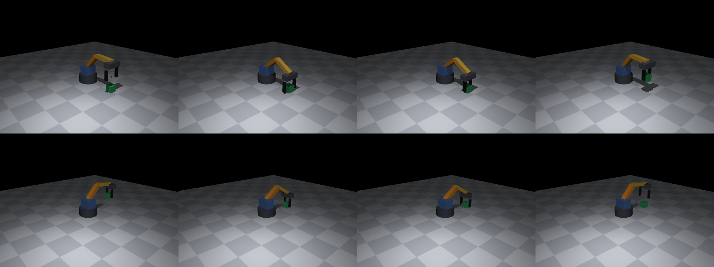

# 3-Axis Robot Arm

A MuJoCo feasibility model of a small desktop pick-and-place arm, built to test the design before buying parts or doing CAD.



## Design

- **Axes:** base rotation, shoulder and elbow
- **Links:** 120 mm upper arm and 120 mm forearm, with a target reach of 200 mm
- **Gripper:** parallel-jaw, driven by a fourth servo and kept level by a passive parallel linkage
- **Payload:** 200 g design target
- **Planned servos:** 12 V STS3215 serial bus servos, assumed to be rated at 30 kg·cm (2.94 N·m)

## Setup

```sh
python3 -m venv .venv
.venv/bin/pip install -r requirements.txt
```

## Usage

```sh
.venv/bin/python check_arm.py      # reach and pick-and-place checks
.venv/bin/python more_checks.py    # stress tests that look for failure points
.venv/bin/python render_frames.py  # regenerate pick_and_place.png
```

To watch the run live on macOS:

```sh
.venv/bin/mjpython view.py
```

If that fails with `bad interpreter` because the folder path contains a space, use:

```sh
.venv/bin/python .venv/bin/mjpython view.py
```

## Results

With a 200 g, 40 mm cube, picked at 200 mm reach and placed 90° around the base:

| Check | Result |
|---|---|
| Table-level pick range | 65–235 mm |
| Peak torque | 0.78 N·m shoulder, 0.43 N·m elbow, 0.54 N·m base |
| Placement error | 1.9 mm |
| Unwanted collisions | None |

`check_arm.py` marks a run as PASS when the cube is lifted and lands within 10 mm of the target. In `more_checks.py`, cubes offset 10 or 20 mm along the arm show FAIL even though they are gripped and carried, because the offset carries through to the placement.

## Limitations

- Link and gripper masses are estimates.
- The model has no gear backlash or frame flex, so the placement error is not a real-world accuracy figure. Plan for ±2–3 mm or worse.
- The parallel linkage is an ideal constraint with no friction, play or added mass.
- The servo model is simplified, so its tracking lag during moves does not represent real hardware.
- The servo rating has not been measured on real hardware.

## Files

| File | Purpose |
|---|---|
| `arm.xml` | MuJoCo model |
| `check_arm.py` | Inverse kinematics, motion script and main checks |
| `more_checks.py` | Stress tests |
| `render_frames.py` | Renders the contact sheet |
| `view.py` | Live viewer |
| `pick_and_place.png` | Frames from the baseline run |
